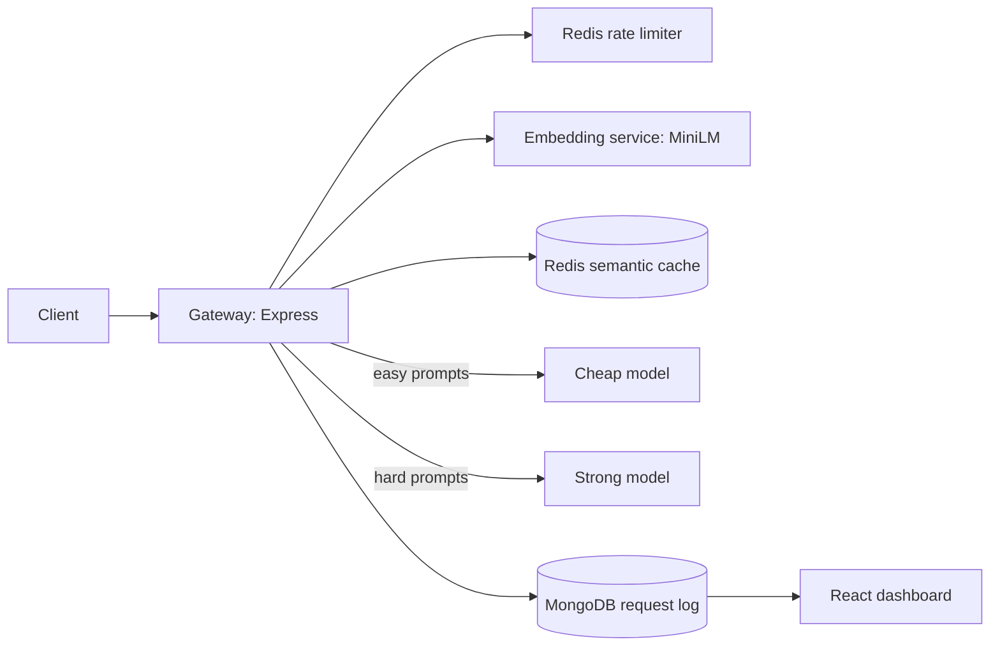

# LLM Gateway

A proxy that sits between an app and LLM providers. It adds a semantic cache, a prompt router that sends easy prompts to a cheaper model, rate limiting, provider fallback, request logging, and a live dashboard.



## Run it
```
cp .env.example .env      # add your GEMINI_API_KEY
docker compose up -d --build
```
Open http://localhost:3000 for the dashboard (it has a "Try it" box). Or call the API:
```
curl -X POST localhost:3000/v1/chat -H "x-api-key: me" -H "content-type: application/json" -d '{"prompt":"What is Redis?"}'
```

## What it does
- **Semantic cache.** Embeds each prompt (all-MiniLM-L6-v2) and reuses a stored answer when cosine similarity is at least 0.90.
- **Router.** Logistic regression over the same embedding predicts whether a prompt needs the strong model. Cache failures never block a request.
- **Rate limiting.** Token bucket in Redis (Lua, atomic). `API_KEYS` restricts which keys are accepted.
- **Fallback.** If a model call fails, the next provider is tried and the failure is logged.
- **Dashboard.** Cache hit rate, route split, p50/p95 latency, requests per hour, from `GET /v1/stats`.

## Measured results
These come from small datasets I built myself, so treat them as indicative, not as production numbers.

**Cache threshold** (`node bench/bench.mjs`: 112 labelled prompts, 28 intents including look-alike pairs such as Redis/MongoDB and git rebase/merge):

| threshold | hit rate | wrong-hit rate |
|---|---|---|
| 0.70 | 73.2% | 7.3% |
| 0.80 | 60.7% | 2.9% |
| 0.85 | 51.8% | 3.4% |
| **0.90** | **40.2%** | **0.0%** |
| 0.95 | 16.1% | 0.0% |

The maximum possible hit rate on this set is 75%. I use 0.90 because a wrong cache hit is worse than a miss. The threshold was tuned on the same prompts it is reported on (no held-out set).

**Router** (`node bench/train_router.mjs`): 100 hand-labelled prompts, 5-fold cross-validation: 97% accuracy, 94% of hard prompts caught, 100% of easy prompts kept on the cheap model.

**Eval** (`node --env-file=.env eval/run.mjs`: 40 prompts with checkable answers, scored by string match):

| strategy | correct |
|---|---|
| always cheap model | 97.5% (39/40) |
| always strong model | 100% (40/40) |
| routed (32 of 40 sent to the cheap model) | 97.5% (39/40) |

The one routed miss was a short reasoning question (counting primes between 20 and 50) that the router judged easy. The router's training set had few short reasoning prompts. The test set was too easy to separate the two models, so this does not prove the router protects quality. I also did not compute a dollar saving: token counts here exclude the strong model's thinking tokens and the models are priced differently.

## Known limits
- One cache shared by all users, scanned linearly. Use a vector index and per-tenant namespaces at scale.
- No cache expiry or eviction; it stops adding at 5000 entries.
- Stats summarize the newest 5000 log entries in application code.
- Eval scoring is a string match and can mark correct answers wrong (it did once, for a LaTeX fraction).

## Develop
```
npm install && npm test          # 12 unit tests, no network needed
cd dashboard && npm install && npm run dev   # dashboard on :5173, proxies to the gateway
```
CI runs the tests and builds the dashboard on every push.